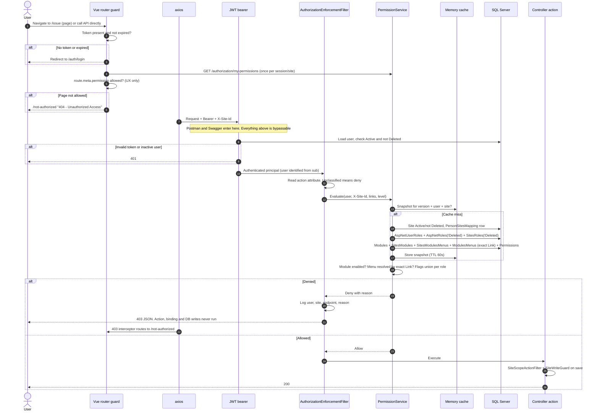

# Meldep: Centralized RBAC Security Analysis and Implementation Plan (Phase 1)

## Context

Menus are hidden by role, but direct URLs and direct API calls are not stopped. You asked for an analysis-only review and a codebase-specific plan for centralized authorization on your nine existing tables, with no schema change. Nothing has been modified, and no database was queried.

**How far to trust this document**
- **Read** = I read the code line myself. **Sweep** = found by a repo-wide search and not read line by line.
- Nothing was run or exploited. Vulnerabilities come from reading the code.
- `ModulesMenus` rows are not in the repo (no seed scripts, no migrations). Every `Link` value below is inferred from Vue routes and **must be checked against your database** (see Phase 0).

## Key findings

1. **Permissions are not enforced anywhere.** The only runtime use of a permission flag is `IsShowMenu` when building the menu (`SitesModulesService.cs:90`, Read). `IsView` and `IsManage` are never used to allow or deny anything. Of the 830 action attributes in 91 controllers (Sweep), none has a role or policy check.
2. **`X-Site-Id` is trusted without checks.** `GlobalVariableMiddleware.cs:21` copies the header with no membership check, before authentication runs (Read). Changing the header switches tenant.
3. **Four anonymous endpoints allow account takeover or credential exposure** (Read):
   - `/auth/mslogin` issues a real JWT from an unverified token.
   - `/auth/reset-password` ignores the reset token.
   - `/auth/user` returns the whole user entity.
   - All of `RolesController` is anonymous.
4. **Any logged-in user can grant themselves access.** The permission-write endpoints have no check beyond `[Authorize]`.
5. **Turning on `IsView`/`IsManage` enforcement today would probably lock out most users.** `assignRolesToMenu` writes `IsView=false, IsManage=false` (`ModulesMenusController.cs:324-325,337-338`, Read), and the live admin screen cannot set them. Most rows are therefore likely `show=1, view=0, manage=0`. This is the largest rollout risk and needs a data decision (Decision 1).
6. **Cross-site record access (IDOR) is real.** `IssueController.DeleteIssue` (`:411-425`) loads the record through `IssueService.GetIssueById` (`:575-580`), which filters only on `Id` (Read). Any logged-in user with an ID can delete an issue in any site. The same pattern probably repeats in many controllers.

---

## A. Current application architecture

| Area | Actual implementation |
|---|---|
| Solution | `API/Vsky.sln`, all `net7.0`: Api, Api.Framework, Core, Data, Models, Services. No test project. |
| Layers | Controllers → `Vsky.Services/<Feature>` → generic `IRepository<T>`/`EfRepository<T>`. 27 controller files also use `ApplicationDbContext` directly (Sweep). |
| Data access | EF Core 7 on SQL Server. Dapper once (`ProjectService.cs:2354`). `FromSqlRaw` at `ProjectsController.cs:2274`. No `HasQueryFilter` or `SaveChanges` override in `ApplicationDbContext.cs`. |
| Authentication | ASP.NET Identity + JWT bearer in `Program.cs:254-311`. Issuer, audience, lifetime and key are validated; `ClockSkew=0`. |
| Per-request user check | `OnTokenValidated` (`Program.cs:279-299`) rejects inactive or deleted users. This is a good base and takes effect immediately. |
| Token issue | `AuthController.GenerakeToken` (`:95-126`). Claims: `sub`, `unique_name`, `jti`, `iat`, `email`, `iss`, and one role claim per role. No site ID. 30-day expiry (`JwtIssuerConfig.cs:16`, Sweep). No refresh and no revocation. |
| Authorization config | No `AddAuthorization`, policies, fallback policy or global filters. `BaseController` has `[ApiController][Authorize]` (`:12-14`). `AccessDenied()` (`:58`) has no callers (Sweep). |
| Pipeline (`Program.cs:604-667`) | Dev: MiniProfiler/Swagger → DeveloperExceptionPage or HSTS → ResponseCompression → ExceptionHandler → StaticFiles → ForwardedHeaders → CORS → Routing → **GlobalVariableMiddleware** → Authentication → Authorization → MapControllers |
| Current user | `User.GetLoggedInUserId<string>()` (`ClaimsPrincipalExtensions.cs:15`), 569 uses (Sweep) |
| Current site | `_globalVariable.SiteId`, scoped service filled from the header, 570 uses (Sweep). Some endpoints also accept `siteId` from body, query or route. |
| Existing role checks | 21 private `IsCurrentUserAdmin`/`IsCurrentUserPM` helpers using hardcoded role names (e.g. `IssueService.cs:807`) that only shape query results and `CurrentUserManage` UI flags |
| Reusable pieces | `GetRoleIdsByUserAndSite`, `GetRolesBySiteId`, `PersonSitesMappingService.GetPersonInSite` (`:195`) |
| Vue stack | Quasar 2, Vue 3, Pinia, vue-router 5 in history mode. 71 module `routes.js` files are merged in `src/router/index.js`. |
| Guards | Two `beforeEach` guards, both token-presence only: `router/index.js:173-208` and `boot/auth.js:6-38`. The `requiresAdmin` branch is unused because no route declares it (Sweep). |
| Frontend state | Token and user in LocalStorage. Menu held per component, no store. `boot/axios.js:26-64` adds `Bearer` and `X-Site-*`. |
| Permission use in Vue | No `IsView`/`IsManage` consumption. About 183 hardcoded role checks in 57 files (Sweep). The only flag toggles are in `sitePermissions.vue`, whose route is commented out. |

No SignalR, Hangfire or hosted services were found (Sweep).

## B. Database relationship analysis

```
AspNetUsers ──< AspNetUserRoles(UserId, RoleId, SiteId) >── AspNetRoles
                                                              │ RoleId
Sites ──< SitesRoles(SiteId, RoleId) ─────────────────────────┘
              │ Id = SiteRoleId
              ▼
SitesModulesMenusPermissions(SiteId, SiteRoleId, SiteModuleMenuId, IsShowMenu, IsView, IsManage)
              ▲ SiteModuleMenuId
SitesModulesMenus(SiteId, SiteModuleId, MenuId) ──> ModulesMenus(ModuleId, Link, ParentMenuId) ──> Modules
              └── SiteModuleId ──> SitesModules(SiteId, ModuleId) ──> Modules
```

**How permissions are read today** (`ModulesController.GetSiteActiveModulesMenus:116-143`, `SitesModulesService:74-104`, Read): user + site → `AspNetUserRoles.RoleId` → matching `SitesRoles.Id` → `.Any(permission in those SiteRoleIds && !Deleted && IsShowMenu)`.

**Inconsistencies to design around**

| # | Finding | Evidence |
|---|---|---|
| 1 | **There is a tenth table involved.** Site membership lives in `PersonSitesMapping(PersonId, SiteId, IsSharedUser, LastUsed, Deleted)`, reached through `AspNetUsers.PersonId`. It is read-only for this work, so no schema change is needed. | `PersonSitesMappingService:195` Read |
| 2 | The menu query ignores `SitesModules.Active`, `SitesModulesMenus.Active`, `Modules.Active/Deleted`, `ModulesMenus.Deleted` and `AspNetRoles.Deleted`. | `SitesModulesService:78-90` Read |
| 3 | Site-level `Active` flags are unreliable. Create paths leave them false; `SitesModulesMenus.Active` only changes through `UpdateMenu`. **Filtering on it could hide many menus.** | Sweep; audit required |
| 4 | Deleted roles keep granting access. `DeleteMasterRole` does not cascade, and `GetRoleIdsByUserAndSite` does not check `Deleted`. | `ApplicationUserRoleService:48-54` Read; rest Sweep |
| 5 | No unique indexes, so duplicate permission or site-role rows are possible, and `FirstOrDefault` picks an arbitrary one. | Sweep |
| 6 | `ParentMenuId` has no FK. `Link` has no uniqueness guarantee. | Sweep |
| 7 | JWT role claims are **not site-scoped** (`GetRolesAsync`, `AuthController:221`). **`[Authorize(Roles=...)]` must never be used here**: a user who is Admin on site A would pass on site B. | Read |
| 8 | `IsPrimaryRole` is never read by any code. | Sweep |
| 9 | `SitesModulesMenusPermissionsService:70` sets `SitesModulesMenus.Id = x.Id`, which is the permission ID and not the menu ID. | Read |
| 10 | "RoleId" means different things in different places (SiteRoleId vs AspNetRoles.Id). | Partly Read |
| 11 | `Vsky.Database/schema_identity.sql` is out of date: its `AspNetUserRoles` primary key omits `SiteId`. **The real schema must be confirmed from the database.** | Sweep |
| 12 | `GetModuleMenusWithRoles:162` returns only roles with `IsShowMenu`, so a view-only role would disappear from the admin screen. | Read |

## C. Security gap analysis

### Critical: fix first, independent of RBAC

| # | Location | Current behavior | Risk | Correction | Evidence |
|---|---|---|---|---|---|
| C1 | `AuthController.GetSecureData` (`/auth/mslogin`) `:321-363` | `ReadToken` with no signature check, then issues a real JWT for the `unique_name` email. Skips `Active`/`Deleted` at login. | **Anyone can forge a token and become any user.** | Validate against Microsoft's signing keys, tenant and audience. The SPA currently sends a Graph `user.read` access token (`login.vue:146,151`), which this API can't validate, so send `idToken` instead. | Read |
| C2 | `AuthController.ResetPassword` `:471-473` | Generates its own token and applies it. `model.Token` is ignored. | **Anyone who knows an email can set that user's password.** | Require the emailed token. The email link has no token today (`WorkflowMessageService.cs:445`), so the link and `reset_password.vue` must change too. | Read |
| C3 | `AuthController.GetUserById` `:442-450` | Anonymous; returns the whole `ApplicationUser`. | Exposes password hash and security stamp, with no ID check. | Replace with a token-validated lookup that returns only the email, for `reset_password.vue:121-122`. | Read |
| C4 | `RolesController` `:27` | Class-level `[AllowAnonymous]`, including role create, update and delete. | Anonymous role tampering. | Remove it and classify as admin. | Read |
| C5 | `ModulesMenusController` `:272,299,351`, `ModulesController.SaveSitesModules`, `SiteController`, `UsersController` role writes | `[Authorize]` only. `:312,320,351` trust a client site ID. `:281` loads by ID with no site check. | **Self-service privilege escalation, across sites.** | Admin-only, and bind the site to the validated active site. | Read |
| C6 | `EmployeeLeaveController.UpdateEmployeeLeave` `:677-680` | Anonymous `PUT`. | An unauthenticated caller can change leave records. | Require auth and Manage. Confirm the email approval flow (Decision 10). | Read |
| C7 | `AuthController.getUserByToken` `:136` | `ReadJwtToken` with no validation; returns profile data for any `email` claim. | User and site data disclosure from a forged token. | Validate the token. Confirm which systems issue SSO tokens (Decision 11). | Read |

### High: the core of this project

| # | Location | Current behavior | Risk | Correction | Evidence |
|---|---|---|---|---|---|
| H1 | `GlobalVariableMiddleware.cs:21` | Trusts `X-Site-Id`. | Full tenant switching through a header. | Validate membership in the central filter. | Read |
| H2 | All controllers via `BaseController` | Login is the only check on 790+ actions. | No function-level authorization. | Central permission filter, deny by default. | Sweep |
| H3 | `SiteController.GetGlobalSiteData` `:256-268` | Returns data for any `siteId`, with no membership check. | Site enumeration and a switch to any tenant. | Membership check on the target site. | Read |
| H4 | `PersonSitesMappingController.UpdateLastUsedSite` `:270-290` | Takes `userId`, `personId`, `siteId` from the client and never compares them to the caller. | Change anyone's last-used site and audit fields. | Derive identity from the JWT and validate the target. | Read |
| H5 | `IssueController` `:120-125,254,417,495` and similar | Load by ID only. | IDOR across sites and within a site. | Write guard plus scoped lookups (Section E). | Read for Issue; others to confirm |
| H6 | `SiteController.GetSiteById` `:232`, `GetAllSiteModuleMenuListForDropdown:214-215`, `ModulesController.GetAllModules:102-108` | Accept any site ID. | Cross-tenant configuration reads. | Site-scope filter. | Read |
| H7 | `CompanyController.cs:134`, `EmployeesController.cs:272` | Body `SiteId` overrides the active site. | Cross-site writes. | Site-scope filter. | Sweep |
| H8 | `UsersController.cs:546` | System-super-admin check has no site condition and `:547` honors a client `siteId`. | Acceptable only if this role is truly global. | Move to the central service (Decision 5). | Read |
| H9 | `CronjobController` (class anonymous), `HelpDeskController` `:702,1414,1637`, `ProjectActivitiesController:1308` | Anonymous, and cron jobs are GETs that send email. | Anyone can trigger jobs or create tickets. | Shared-secret attribute, or remove anonymous. | Sweep |
| H10 | 2 `Contact`, `DropDownTypes:222`, `JobCreate`, `Candidate`, `Calendar`, `Modules:83`, `WebsiteDemos` | Anonymous. Some are clearly public-website endpoints. | Needs an explicit allowlist. | Review (Decision 9). | Sweep |
| H11 | `SitesModulesMenusService.GetAllModuleMenusForDashboard`, `GetLandingPageBySiteId`, `GetAllModules` | No role check. | Reveals menus. **A landing page may be one the user cannot open.** | Make them role-aware. | Sweep |

### Supporting

| # | Location | Issue | Correction |
|---|---|---|---|
| S1 | `Program.cs:650` | Returns `exception.ToString()` to clients, with a 401 code in a 500 response (Read). | Return a reference ID only (the commented line at `:649` already does this). |
| S2 | `web.config:18` (tracked) | `ASPNETCORE_ENVIRONMENT=Development`. If deployed as is, **Swagger and the developer exception page are public** (Read). No publish profile overrides it. | Check production; set per environment. |
| S3 | `Program.cs:300-308` | `OnAuthenticationFailed` flushes a body and doesn't end the request. By framework behavior, an invalid token on an **anonymous** action would still run the action, and a later challenge may fail because the response has started. **Inferred, not tested.** | Move the body to `OnChallenge` and test. |
| S4 | `boot/interceptors.js:59` | `authStore.logout()` returns nothing, so `.then` throws; `useRouter()` is also called outside setup (Read). **The 401 redirect never runs.** | Use the `router` boot parameter. |
| S5 | `login.vue:122` | "Remember me" saves the login model, including the password, to LocalStorage (Read). | Save the username only. |
| S6 | `ServiceExtensions.cs:14` | Applied CORS policy allows any origin; `AllowSpecificOrigins` is defined and unused (Sweep). | Apply the allowlist. |
| S7 | `sites/routes.js`, `module/routes.js` | `/sites/site-menu-role-permissions` and `/modules/:id/menus` have no `requiresAuth` (Sweep). | Add it. |
| S8 | `wwwroot/uploads/expenselines/...`, Azure `PublicAccessType.Blob` | Expense attachments can be read anonymously by URL (Sweep). | Separate workstream (Decision 12). |
| S9 | `API/Vsky.Api/App_Data/` | Data-protection keys are untracked and not ignored (Sweep). | Add to `.gitignore` so they can't be committed. |
| S10 | `JwtIssuerConfig.cs:16` | 30-day tokens. Deactivation is immediate but password change isn't (Sweep). | Shorter lifetime; add a security-stamp check using the existing column. |
| S11 | `Vsky.sln` | `net7.0` is out of support. | Note only; out of scope. |

## D. Multi-site and multi-role analysis

| Question | Current behavior (verified) | Secure? | Target |
|---|---|---|---|
| How is active SiteId determined? | Login picks `LastUsed`, otherwise an unordered first row. After that, the client sends `X-Site-Id` from LocalStorage. `mslogin` ignores `LastUsed`. | **No** | Header stays as the selector, but is validated on every request. |
| How is the user tied to the site? | Nothing checks this per request. `PersonSitesMapping` is only used for listing. | **No** | Non-deleted `PersonSitesMapping` row **and** at least one valid role in that site. |
| How are `AspNetUserRoles` and `SitesRoles` validated together? | Only in the menu endpoint, in-memory (`ModulesController:126-131`). `AspNetRoles.Deleted` is ignored. | **Partly** | One query joining all three, including `!Deleted`. |
| How do multiple roles combine? | `.Any` = OR, for `IsShowMenu` only. No primary-role logic. | Not applicable | Explicit rule below. |
| What stops site A's permissions being used on site B? | The menu query filters by site, but **no API uses that result**. | **No** | Every permission row must match the validated site on row, role and menu. |
| What does switching sites do? | `user_info.vue:224-243` updates `LastUsed`, fetches site data, and rewrites LocalStorage. **Same JWT, no check.** | **No** | Target validated server-side; no new token needed, because site is checked per request. |
| How do changes and revocations apply? | Deactivating a user is immediate. Permission changes affect only the menu after reload. **Removing a role removes nothing else, since nothing is enforced.** | **No** | Bounded by cache: immediate on the same server, at most 60 seconds otherwise. |

**Recommended role-combination rule** (Decision 2). OR is not assumed; it is the recommendation for these reasons:
- The schema has no way to express "deny". A `false` means "not granted", and `assignRolesToMenu` writes `false` as a default, so a deny-wins rule would let any newly assigned role remove access granted by another.
- Nothing in the code gives `IsPrimaryRole` a meaning, so primary-role-only would be inventing behavior and would remove access from users who rely on a secondary role.

So:
1. Validity gates run first. Rows from deleted roles, other sites, or inactive menus count for nothing.
2. **Different roles:** per-flag union of valid rows.
3. **Duplicate rows for the same role and menu (a data conflict):** fail closed by requiring every duplicate to grant the flag, and log it.
4. **Missing row:** deny.

## E. Proposed centralized architecture

**One chokepoint: a global authorization filter, an ASP.NET requirement and handler, and one permission service.** No new tables and no new JWT claims. Permissions stay out of the token so revocation works and a 30-day token can't carry stale rights.

| Component | Proposed location | Responsibility |
|---|---|---|
| Classification attributes | `Vsky.Api/Authorization/` | Declare what each action needs (tiers below). |
| `MenuLinks` | `Vsky.Api/Authorization/MenuLinks.cs` | One constant per `ModulesMenus.Link`. Prevents typos. |
| `AuthorizationEnforcementFilter` | `Vsky.Api/Authorization/` (global `IAsyncAuthorizationFilter`) | Runs **before model binding and the action**. Reads the attribute, **denies unclassified actions**, and calls `IAuthorizationService`. Writes the audit log. |
| `MenuPermissionRequirement` + `MenuPermissionHandler` | `Vsky.Api/Authorization/` | Standard ASP.NET requirement and handler; contains no data access. |
| `IPermissionService` / `PermissionService` | `Vsky.Services/Authorization/` | **The only decision logic.** Builds a snapshot for user + site. Also feeds the Vue endpoint and the menu. |
| `PermissionCacheInvalidationInterceptor` | `Vsky.Services/Authorization/` | EF `SaveChangesInterceptor`. Any change to the relevant tables bumps a version, which invalidates the cache. Centralized, so no write site can forget. |
| `SiteScopeActionFilter` | `Vsky.Api/Authorization/` | After binding: rejects `siteId` arguments or model `SiteId` that differ from the active site, unless System Super Admin. |
| `SiteWriteGuardInterceptor` | `Vsky.Services/Authorization/` | Rejects modify or delete on an entity whose `SiteId` differs from the active site. Fixes cross-site IDOR writes without editing each controller. Audit mode first. |
| `AuthorizationController` | `Vsky.Api/Controllers/` | `GET /authorization/my-permissions`, for the Vue store. |
| Vue store, guard, composable | `WEB/src/...` | UX only. |

**Why this design**
- **Filter rather than middleware:** a filter has action metadata and runs before binding. Middleware would need to reimplement this.
- **Filter rather than `[Authorize(Policy="...")]` strings:** .NET 7 lacks `IAuthorizationRequirementData`, so a policy approach needs a custom provider that parses strings. A filter also gives audit mode and deny-by-default in one place.
- **Explicit level rather than inferring from HTTP verb:** about 138 of 321 POST actions are reads such as `POST /Timesheet/list` (Sweep; a rough regex, with some false positives). Inferring from the verb would wrongly require Manage for them.
- **No EF global query filter yet:** 77 of 169 model files have `SiteId` (Sweep). A filter could silently empty results for cron, anonymous and super-admin flows. The write guard plus scoped lookups is safer now; it can be revisited later.

**Endpoint tiers** (every action must be in exactly one)

| Tier | Attribute | Checks | Examples |
|---|---|---|---|
| T0 Public | existing `[AllowAnonymous]`, reviewed allowlist | None | `auth/login`, website forms |
| T1 Service | `[ServiceKey]` | Shared secret from config | `cron-job/*`, email webhooks |
| T2 Authenticated | `[AuthenticatedOnly]` | Valid user | `my-share-sites-list`, site switching, `my-permissions`, `account/*` |
| T3 Site member | `[SiteMember]` | T2 + site gates | `common/*`, dropdown lookups, notifications, `/dashboard` shell |
| T4 Menu permission | `[RequirePermission(Level, links...)]` | T3 + menu rules; any listed link can satisfy it | Almost all business APIs |
| T5 Administrator | `[RequireSiteAdmin]`, `[RequireSystemAdmin]` | T3 + role by normalized name in **this** site | Permission, role, module, site management |

**Modes:** `Authorization:Mode = Off | Audit | Enforce`, plus an enforced-link list for gradual rollout. Audit logs what *would* be denied and allows the request. This is the main protection against regressions.

**Caching:** `IMemoryCache`, keyed by `version + userId + siteId`, 60-second TTL (`AddMemoryCache` to add). If production runs on several servers, invalidation is local and the TTL is the ceiling (Decision 8).

**Layers of authorization:** menu permission answers "may this user use this function?". It does **not** answer "may they touch this project's record?". The existing `CurrentUserManage` calculations only shape UI flags and need a later server-side guard for the highest-risk writes (Phase 7).

## F. Complete authorization flow



## G. Permission evaluation matrix

**Proposed semantics** (Decision 1 confirms)

| Operation | Required | Notes |
|---|---|---|
| Show in navigation | `IsShowMenu` **and** (`IsView` or `IsManage`) | Prevents a menu link that leads to an error page |
| Open page: list, detail | `IsView` or `IsManage` | `IsManage` implies view |
| Read APIs: list, detail, `POST .../list`, dropdown tied to a menu | `IsView` or `IsManage` | Level is explicit, not by verb |
| Export | `IsView` or `IsManage` | **Confirm:** exports are bulk data, so some teams require Manage |
| Create, update, delete, status change, assign | `IsManage` | |
| Import, bulk upload | `IsManage` | |
| Approve or reject | `IsManage` on the approval menu | e.g. `/weekly-timesheet-approval`, separate from `/timesheet` |

**Flag combinations**

| Show | View | Manage | Menu visible | Page/read | Write | Comment |
|---|---|---|---|---|---|---|
| 0 | 0 | 0 | No | Deny | Deny | Same as no row |
| 1 | 0 | 0 | **No, after cutover** | **Deny** | Deny | **Likely today's most common row. Requires backfill.** |
| 0 | 1 | 0 | No | Allow | Deny | Hidden but reachable by link |
| 1 | 1 | 0 | Yes | Allow | Deny | Read-only user |
| 0 | 0 | 1 | No | Allow | Allow | Hidden; used for sub-features |
| 1 | 0 | 1 | Yes | Allow | Allow | |
| 1 | 1 | 1 | Yes | Allow | Allow | Full access |

**Always deny, regardless of flags:** permission row deleted; missing row; deleted role or site role; deleted or inactive module or menu; module not enabled for the site; user not a member of the site; `Link` not found or ambiguous; row, role and menu disagree on `SiteId`.

## H. URL and API mapping strategy

**Backend does not match URLs.** The API authorizes from attribute metadata on the matched endpoint, using a `Link` key. This removes the risk of partial URL matching entirely.

**Link lookup** is exact after normalization: trim, remove query and fragment, remove trailing slash, compare case-insensitively. Absolute `http...` links are excluded. **No `StartsWith` or `Contains` anywhere**, so `/project` never matches `/project-tasks`. If zero rows or an ambiguous result is found: deny and log.

**Frontend** uses route metadata rather than the URL: `meta: { permission: { menu: "/customer", level: "view" } }`. Params and query strings then need no parsing, and a sub-page inherits explicitly from its parent. A protected route with no `permission` is denied, except for an explicit `public` or `siteMember` declaration.

**Concrete examples**

| Vue route | Permission key | API | Level | Note |
|---|---|---|---|---|
| `/timesheet` | `/timesheet` | `POST /Timesheet/list` | View | POST that reads |
| `/weekly-timesheet-approval` | same | `POST /Timesheet/weekly-timesheet-approval-list` | View | Own menu |
| `/project-targetplan/weeklyplanner` | same | `POST /projects/get-project-weekly-plan` | View | In the 54-action `ProjectsController`, so **classified per action** |
| `/my-daily-planner` | same | `POST /daily-planner/list`, `PUT`, `DELETE /daily-planner/{id}` | View / Manage | |
| `/issue` | `/issue` | `POST /issue/list`; `DELETE /issue/{id}` | View / Manage | Delete also needs the write guard |
| `/project-center` | `/project-center` | Issue tab reads `/issue` APIs | View | `/issue/list` declares any-of `/issue`, `/project-center` |
| `/test-case?planId=1` | `/test-case` | `/test-case/*` | View | Query string ignored |
| `/customer/customer-center` | parent `/customer` | `/customer/*` | View | Sub-page with no own menu |
| `/modules/:id/menus` | parent `/modules` | `/menus/*` | Admin (T5) | Route param |
| `/report-list/:reportId` | `/reports` | `/reports/*` | View | Keeps existing report-role mapping as well |
| `/sites/site-menu-role-permissions` | Admin | `POST /menus/assignRolesToMenu` | T5 | Also bind site server-side |
| `/dashboard` | Site member | `/project-dashboard/*`, others | T3/T4 | Widgets must tolerate 403 |

**Mapping controllers to Links** (starting point for review, per-action overrides expected)

| Group | Controllers | Proposed Link(s) |
|---|---|---|
| Project | `Projects`, `ProjectUserMapping`, `ProjectSwimlane`, `SiteProjectRoles`, `AllProjectPlanner`, `ProjectDashboard` | `/project`, `/project-center`, `/all-project-planner`, `/project-targetplan/weeklyplanner`, `/project-targetplan/monthlyplanner`, `/project-planning/*`, per action |
| Work | `ProjectTasks`, `ProjectActivities`, `ProjectModules`, `ProjectModulesUserMapping`, `ProjectActionItems`, `ProjectQuestionsAnswers`, `ProjectReleaseTracking` | `/project-tasks`, `/my-task-and-activities`, `/project-modules`, `/project-action-items`, `/project-questions-answers/list`, `/project-release-tracking/list` |
| QA | `Issue`, `TestPlan`, `TestCase` | `/issue`, `/test-plan`, `/test-case` |
| Requirements | `Requirement`, `RequirementGroup`, `RequirementDashboard`, `RequirementDataMapping`, `RequirementStatusTracking` | same-named routes, `/requirement-center` |
| Time | `Timesheet`, `TimesheetAISummary`, `DailyPlanner`, `TimeInTimeOut`, `MovementRegister` | `/timesheet`, `/weekly-timesheet`, `/weekly-timesheet-approval`, `/billing-processing*`, `/my-daily-planner`, `/time-in-time-out/list`, `/movement-register/list` |
| HR | `Employees`, `EmployeeOrgStructures`, `Departments`, `Person`, `EmployeeLeave`, `LeaveCredit`, `LeaveRules`, `LeaveSchedule` | `/employee`, `/employee-org-structure`, `/department`, `/person`, `/apply-leave`, `/approve-leaves`, `/forward-leaves`, `/leave-credit`, `/leave-rules`, `/leave-yearly-schedule` |
| CRM | `Company`, `CompanyContact`, `Customer`, `CustomerFiles`, `Candidate`, `Leads`, `LeadUserGroupMapping`, `SalesPerson`, `JobCreate`, `Contact` | same-named routes |
| Finance | `Expense`, `ExpenseAdvanceRequest`, `ExpensePurchaseRequest`, `ExpenseBankAccount`, `ExpenseVendorBankAccounts`, `ExpenseEmployee` | `/finance-*`, `/approve-expense`, `/approve-advance-expense`, `/approve-purchase-expense` |
| Infra | `InfraAccount`, `InfraAccountServices`, `InfraDashboard`, `InfraDatabase`, `InfraFTP`, `InfraProjectInstance`, `Server`, `Domain` | `/infra-*` (Server and Domain to confirm) |
| SOP, marketing, other | `SOPTemplate`, `SOPProcess`, `SOPAssignment`, `AdPost`, `AdPostChannel`, `Inventory`, `TrainingPortal`, `Tags`, `HelpDesk`, `HelpDeskTopicsQuestions`, `Reports`, `ReportUserMapping`, `ItemCategory`, `ItemSubCategoryAttributes`, `SitesItems`, `SitesItemSubCategoryAttributesMapping` | same-named routes, `/item/*` |
| Admin (T5) | `Modules`, `ModulesMenus`, `Roles`, `Site`, `Users`, `PersonSitesMapping`, `DropDownTypes`, `DropDowns`, `EmailNotification` | Mixed: writes T5; lookups T3 |
| Shared (T3) | `Common`, `Notes`, `Notification`, `Account` | Notes is polymorphic (`subModuleId` + `type`), so needs a site check on the parent |
| Public/service | `Auth`, `WebsiteDemos`, `Cronjob`, `Calendar` | T0/T1 per Decision 9 |

## I. File-by-file implementation plan

All controller and method names below exist today except those marked **NEW**.

### New files

| Path | Purpose | Depends on | Result |
|---|---|---|---|
| `API/Vsky.Services/Authorization/IPermissionService.cs`, `PermissionService.cs`, `PermissionSnapshot.cs` **NEW** | All decision logic | `ApplicationDbContext` | Single source of truth |
| `API/Vsky.Services/Authorization/PermissionCacheInvalidationInterceptor.cs` **NEW** | Bump cache version on change | EF | Fast revocation |
| `API/Vsky.Services/Authorization/SiteWriteGuardInterceptor.cs` **NEW** | Block cross-site writes | `GlobalVariable` | IDOR write protection |
| `API/Vsky.Api/Authorization/AuthorizationEnforcementFilter.cs` **NEW** | Global chokepoint | Service | Deny by default |
| `API/Vsky.Api/Authorization/MenuPermissionRequirement.cs`, `MenuPermissionHandler.cs` **NEW** | ASP.NET integration | Service | Testable rules |
| `API/Vsky.Api/Authorization/Attributes.cs`, `MenuLinks.cs`, `AuthorizationOptions.cs` **NEW** | Tiers, constants, modes | None | Declarative |
| `API/Vsky.Api/Authorization/SiteScopeActionFilter.cs` **NEW** | Reject mismatched site IDs | `GlobalVariable` | Closes body/query override |
| `API/Vsky.Api/Controllers/AuthorizationController.cs` **NEW** | `my-permissions` | Service | Vue data source |
| `API/Vsky.Api.Tests/` **NEW** | xUnit + `WebApplicationFactory`; includes a test that fails if any action is unclassified | Above | Regression safety |
| `WEB/src/stores/permissions.js` **NEW** | Pinia store | API | Central state |
| `WEB/src/composables/usePermission.js` **NEW** | `canView`, `canManage` | Store | Replaces role checks over time |
| `WEB/src/router/permissionGuard.js` **NEW** | Route guard logic | Store | Direct URL handling |

### Backend: existing files

| Path | Class / method | Change | Why | Depends on |
|---|---|---|---|---|
| `API/Vsky.Api/Program.cs` | `Main` | Register services, filters, interceptors, `AddMemoryCache`; fix `:650`; fix `:300-308` | Wiring; S1, S3 | New files |
| `API/Vsky.Api/appsettings.json` (**untracked: deploy manually to each environment**) | | `Authorization` section, Microsoft tenant/client, service key | Config | |
| `API/Vsky.Api/web.config` | | Remove `Development` from the deployed configuration | S2 | Confirm environment |
| `API/Vsky.Api/Controllers/AuthController.cs` | `GetSecureData`, `ResetPassword`, `GetUserById`, `getUserByToken` | C1, C2, C3, C7 | Account takeover | Microsoft config |
| `API/Vsky.Api/Models/AuthModels.cs` | `ResetPasswordModel` | Make `Token` required | C2 | |
| `API/Vsky.Services/Messages/WorkflowMessageService.cs` | `SendPasswordResetEmail:445` | Add URL-encoded token to link | C2 | |
| `API/Vsky.Api/Controllers/RolesController.cs` | Class | Remove `[AllowAnonymous]`, T5 | C4 | Filter |
| `API/Vsky.Api/Controllers/ModulesMenusController.cs` | `CreateSiteModuleMenuPermission`, `SaveRolesToSiteModuleMenu`, `DeleteModuleMenuRoleAccess` | T5; bind site; add site check at `:281`; **stop `:336-338` from resetting flags on re-assign** | C5 | Filter |
| `API/Vsky.Api/Controllers/ModulesController.cs` | `GetAllModules`, `SaveSitesModules`, `sitesmenusmanage-permission` | T5, site scope; review `moduleslist` | C5, H6 | Filter |
| `API/Vsky.Api/Controllers/SiteController.cs` | `GetGlobalSiteData`, `GetSiteById`, `:214-215`, create, update | Membership check, T5, pass validated site | H3, H6 | Service |
| `API/Vsky.Api/Controllers/PersonSitesMappingController.cs` | `UpdateLastUsedSite` | Identity from JWT, validate target | H4 | Service |
| `API/Vsky.Api/Controllers/UsersController.cs` | `:175`, `:546-547`, role assignment | Site-scope user lists; central super-admin check | H8 | Service |
| `API/Vsky.Api/Controllers/EmployeeLeaveController.cs` | `UpdateEmployeeLeave`, `GetEmployeeLeaveDetailsById` | Remove anonymous | C6 | Decision 10 |
| `API/Vsky.Api/Controllers/CronjobController.cs`, `HelpDeskController.cs` | Anonymous actions | T1 | H9 | Scheduler and webhook config |
| `API/Vsky.Api/Controllers/*Controller.cs` (all 91) | Class and action | One classification attribute per action, using Section H. **Attributes only, no logic changes.** | H2 | `MenuLinks` |
| `API/Vsky.Api/Controllers/IssueController.cs` and others loading by ID | `GetIssueById`, `DeleteIssue`, ... | Scoped lookups (highest-risk first) | H5 | Phase 7 |
| `API/Vsky.Services/SitesModule/SitesModulesService.cs` | `GetSiteActiveModulesMenus` | Use the same rules as the service | Menu matches enforcement | Decision 1, 3 |
| `API/Vsky.Services/SitesModulesMenusPermission/SitesModulesMenusPermissionsService.cs` | `:70`, `GetModuleMenusWithRoles:122,162` | Fix the ID; return all three flags | Admin screen | |
| `API/Vsky.Services/ApplicationUserRoles/ApplicationUserRoleService.cs` | `GetRoleIdsByUserAndSite`, `GetNormalizedRoleNamesByUserAndSite`, `GetRoleNamesByUserAndSite` | Exclude deleted roles | B#4 | Audit |
| `API/Vsky.Services/SitesRole/SitesRolesService.cs` | `GetRolesBySiteRoleIds`, `GetRoleIdBySiteRoleId` | Add site filter | Cross-site | |
| `API/Vsky.Services/SitesModulesMenu/SitesModulesMenusService.cs` | `GetAllModuleMenusForDashboard`, `GetLandingPageBySiteId` | Role-aware; deterministic | H11 | Service |
| `RoleDto` / `ModuleMenuRoleDto` (locate during Phase 3) | | Add `IsShowMenu`, `IsView`, `IsManage` | Admin screen | |
| `.gitignore` | | Add `App_Data/` | S9 | |

### Frontend: existing files

| Path | Component | Change | Why |
|---|---|---|---|
| `WEB/src/boot/interceptors.js` | `http` response | Fix 401; handle 403 → `not_authorized`; no toast storms; `boot(({store, router}))` | S4 |
| `WEB/src/router/index.js` | `Router.beforeEach` | Single guard; call `permissionGuard`; expiry check | Direct URL |
| `WEB/src/boot/auth.js` | `router.beforeEach` | Remove duplicate guard, or reduce it | Two guards conflict |
| `WEB/quasar.config.js` | `boot` | Only if a new boot file proves necessary | |
| `WEB/src/stores/auth.js` | `logout`, `changeTenant` | Clear the permission store | Site switching |
| `WEB/src/shared/user_info.vue` | Site switch `:224-243` | Handle a denied switch; reload permissions | Multi-site |
| `WEB/src/modules/auth/pages/login.vue` | `:122`, `:146-153`, `redirectToLanding` | Stop storing password; send `idToken`; honor `redirect` query | S5, C1 |
| `WEB/src/modules/auth/pages/reset_password.vue` | `:101-122` | Read and send the token | C2 |
| `WEB/src/pages/not_authorized.vue` | | Restyle as "404 - Unauthorized Access", using the `vsky-ui-standards` skill | Requirement |
| `WEB/src/pages/error.vue` | `:6` | Null-safe link (per Sweep) | Logged-out crash |
| `WEB/src/layouts/layout.vue`, `components/app_menu.vue` | Menu | Use server-filtered result; tolerate 403 in global calls | Menu matches rules |
| `WEB/src/modules/settings/pages/index.vue` | `:56-67` | Keep the display filter; the backend now enforces | No regression |
| `WEB/src/modules/dashboard/pages/index.vue` | Widgets | Handle 403 per widget | Many modules on one page |
| `WEB/src/modules/sites/pages/siteMenuRolePermissions.vue`, `modules/module.service.js` | Admin screen | **Add Show/View/Manage toggles**, so View and Manage can actually be set | Finding 5 |
| `WEB/src/modules/*/routes.js` (71 files), `sites/routes.js`, `module/routes.js` | `meta` | Add `permission` to each route; add missing `requiresAuth` | S7 |
| Pages with `isViewer`/`adminRoles` (57 files) | | Gradually change to `usePermission`. **Not needed for security.** | Consistency |

## J. Implementation sequence

Each phase can ship independently. **Nothing is denied until Phase 5, apart from the Phase 1 fixes and the Phase 3 site check.**

| Phase | Work | Risk | Depends on |
|---|---|---|---|
| **0. Discover** (read-only) | You run the audit queries below; confirm production environment and Decisions | None | None |
| **1. Close critical holes** | C1 to C7, S1, S2, S3, S4, S9. Lock permission-write endpoints with T5 | Low to medium: MS login and password reset flows must be retested | Decisions 5, 10, 11 |
| **2. Foundation in Audit** | Service, filter, interceptors, tests, `my-permissions`. Unclassified actions log only | Low | Phase 1 |
| **3. Site gate and admin UI** | Enforce X-Site-Id membership and T5. Add View/Manage toggles. Fix re-assign reset. Apply the approved backfill | Medium: users lacking a mapping row (audit first) | Decision 1 |
| **4. Classify** | Attribute every action, in Audit. Review logs for 1 to 2 business cycles including month-end and approvals. Adjust | Low | Phase 2 |
| **5. Enforce gradually** | Enable per link: Admin → Finance/HR → CRM → Projects, Tasks, Timesheet (highest traffic last). Instant rollback through config | Medium: main regression point | Phase 4 |
| **6. Vue** | Store, guard, route metadata, 403 handling, page, button visibility | Low: not the security boundary | Phase 2; ship guard with or after Phase 5 |
| **7. Record-level** | `SiteScopeActionFilter` and `SiteWriteGuard` from Audit to Enforce; scoped `GetById`, highest-risk first; project-level write checks | Medium to high | Phase 5 |
| **8. Finish** | Set `Mode=Enforce` for all, make unclassified-action test mandatory in CI, remove Audit paths, shorten JWT, CORS allowlist | Low | Phase 7 |

### Phase 0 audit queries (read-only; please run them and share the results)

These are `SELECT` only. Table names are as you listed them; please adjust if EF maps any differently.

```sql
-- 1. Every menu and its Link
SELECT m.Name AS Module, mm.Id, mm.MenuName, mm.DisplayName, mm.ParentMenuId, mm.Link, mm.Active, mm.Deleted
FROM ModulesMenus mm JOIN Modules m ON m.Id = mm.ModuleId ORDER BY m.Name, mm.DisplayName;

-- 2. Duplicate Links (ambiguous once enforced)
SELECT LOWER(RTRIM(Link)) AS Link, COUNT(*) AS Cnt FROM ModulesMenus
WHERE Deleted = 0 GROUP BY LOWER(RTRIM(Link)) HAVING COUNT(*) > 1;

-- 3. Flag distribution: sizes the backfill (Decision 1)
SELECT IsShowMenu, IsView, IsManage, COUNT(*) AS Cnt FROM SitesModulesMenusPermissions
WHERE Deleted = 0 GROUP BY IsShowMenu, IsView, IsManage;

-- 4. How reliable are site-level Active flags? (Decision 3)
SELECT 'SitesModules' AS T, Active, COUNT(*) AS Cnt FROM SitesModules WHERE Deleted = 0 GROUP BY Active
UNION ALL SELECT 'SitesModulesMenus', Active, COUNT(*) FROM SitesModulesMenus WHERE Deleted = 0 GROUP BY Active;

-- 5. Duplicate permission rows (conflicts)
SELECT SiteId, SiteRoleId, SiteModuleMenuId, COUNT(*) AS Cnt FROM SitesModulesMenusPermissions
WHERE Deleted = 0 GROUP BY SiteId, SiteRoleId, SiteModuleMenuId HAVING COUNT(*) > 1;

-- 6. Users with roles in a site but no membership row (would lose access at Phase 3)
SELECT ur.UserId, ur.SiteId FROM AspNetUserRoles ur JOIN AspNetUsers u ON u.Id = ur.UserId
LEFT JOIN PersonSitesMapping p ON p.PersonId = u.PersonId AND p.SiteId = ur.SiteId AND p.Deleted = 0
WHERE p.Id IS NULL;

-- 7. Role assignments with no matching active SitesRoles row (no permissions resolve)
SELECT ur.UserId, ur.RoleId, ur.SiteId FROM AspNetUserRoles ur
LEFT JOIN SitesRoles sr ON sr.RoleId = ur.RoleId AND sr.SiteId = ur.SiteId AND sr.Deleted = 0
WHERE sr.Id IS NULL;

-- 8. Roles deleted but still assigned
SELECT r.Name, COUNT(*) AS Cnt FROM AspNetUserRoles ur JOIN AspNetRoles r ON r.Id = ur.RoleId
WHERE r.Deleted = 1 GROUP BY r.Name;

-- 9. Actual schema: compare with Vsky.Database scripts
SELECT TABLE_NAME, COLUMN_NAME, DATA_TYPE, IS_NULLABLE FROM INFORMATION_SCHEMA.COLUMNS
WHERE TABLE_NAME IN ('AspNetUsers','AspNetRoles','AspNetUserRoles','Modules','ModulesMenus','SitesModules',
 'SitesModulesMenus','SitesModulesMenusPermissions','SitesRoles','PersonSitesMapping')
ORDER BY TABLE_NAME, ORDINAL_POSITION;
```

## K. Testing strategy

**Automated:**
- **Unit:** `PermissionService` truth table.
- **Integration:** `WebApplicationFactory` with seeded data.
- **Structural:** reflection test failing on any unclassified action. This is what keeps future endpoints secure.

**Manual:** Postman collection per role; browser test per route.

| Area | Scenario | Expected |
|---|---|---|
| Authorized | User with `IsView` opens page and lists; with `IsManage` creates, edits, deletes | Works |
| Unauthorized | View-only user calls `POST`, `PUT`, `DELETE` | 403; **database unchanged** |
| No row | Role with no permission row | Page and API denied |
| Direct URL | Paste restricted URL; open a bookmark; refresh a sub-page; `/customer/customer-center` without parent access | Custom page, no data flash |
| Direct API | Same calls from Swagger, Postman, DevTools, modified parameters | Same result as UI |
| Menu is not access | `IsShowMenu=1`, no View/Manage | Hidden and denied; `IsShowMenu=0`, `IsView=1`: hidden but works |
| CRUD | List, detail, create, edit, delete, import, export for one module per group | Follows matrix |
| POST reads | `POST /Timesheet/list` with View | Allowed |
| Multi-role | View + Manage roles; one role revoked; one role deleted | Union of valid rows only |
| Duplicates | Two rows for one role with conflicting flags | Fails closed, logged |
| Multi-site | Admin on A, nothing on B, `X-Site-Id: B` | 403 |
| Header tampering | Missing, malformed, deleted site, inactive site | Deny |
| Body override | `siteId` in body/query differs from header | 403; System Super Admin allowed per Decision 5 |
| Site switch | Switch to a member site; to a non-member site; membership removed mid-session | Menus and permissions change; denied; next request denied |
| Inactive user | Deactivate during a session; delete | 401 on next request |
| Deleted role | `AspNetRoles.Deleted`, `SitesRoles.Deleted` | Permission gone |
| Deleted permission | Soft-delete a row | Access gone within cache window |
| Inactive config | Module, menu, `SitesModules`, `SitesModulesMenus` inactive or deleted | Deny, per Decision 3 |
| Revocation | Remove `IsManage` while logged in | Immediate on same server; at most 60s otherwise |
| IDOR | Site A user uses a site B record ID for GET, PUT, DELETE; same site without project access | Denied; **Issue delete regression test** |
| Privilege escalation | Non-admin calls `assignRolesToMenu`, `savesitemenupermission`, `/roles`, user role update | 403 |
| JWT | Expired, tampered, wrong key, forged `mslogin`, forged `user-by-token`; expired token on an anonymous endpoint | 401; action doesn't run; correct redirect |
| Password reset | No token, wrong token, reused token, valid token | Only valid token works |
| Regressions | Email approve link, SSO `?token=`, cron jobs, help-desk email, landing page per role, dashboard with partial access, System Super Admin flow | Works as decided |

## L. Risks and regression analysis

| Risk | Impact | Mitigation |
|---|---|---|
| **Most rows have View and Manage false** | Mass lockout | Query 3; approved backfill; Audit mode; admin UI first |
| **Sub-pages and shared APIs** (Dashboard, Project Center, Requirement Center and `layout.vue` call many modules) | A partly permitted user sees errors or a blank page | Any-of links; T3 for lookups; audit logs; per-widget handling |
| **Dropdowns used across modules** | Forms break for users without the dropdown's admin menu | Dropdown *reads* are T3; only management is T5 |
| **Employee self-service** (apply leave, timesheet, own tasks) | Employees need Manage for their own entries | Grant Manage on those menus in the backfill; record checks keep them to their own data |
| **Admin lockout** | No one can fix permissions | Break-glass for Site and System Super Admin (Decision 5) |
| **`Link` edited in the admin screen** | Attribute key no longer matches, causing denial | Diagnostic check comparing `MenuLinks` to the DB; treat Link as read-only once enforced (Decision 6) |
| **Landing page denied** | User sent to the error page straight after login | Role-aware landing with fallback |
| **Unknown API clients** (`wwwroot/mobileApk/Android.apk` exists; AI assistant settings; reporting URL; external SSO) | May not send `X-Site-Id`, or use removed endpoints | Audit logs identify them; Decision 13 |
| **MS login change** | Microsoft users can't log in | Test against a real tenant; token type changes; v2 tokens use `preferred_username`, not `unique_name` |
| **Reset link change** | Links already in inboxes stop working | Acceptable; announce |
| **Global 403 toast noise** | Repeated errors | Interceptor rule |
| **`SiteWriteGuard` blocks legitimate writes** (System Super Admin, cron, anonymous with no site) | Failed saves | Audit first; explicit exemptions |
| **Performance** | Extra query per request | Single composed query plus cache |
| **Merge conflicts** from touching 91 controllers and 71 route files | Slows other work | Attribute-only commits, one group at a time |
| **Uncommitted local changes** in `WEB/config/env.*`, `.quasar/*` | Could be mixed in | Keep them out of RBAC commits |

---

# Final summary

## 1. Proposed architecture

A global `AuthorizationEnforcementFilter` runs before model binding on every action and denies anything unclassified. It calls a standard ASP.NET requirement and handler, which delegate to one `PermissionService`.

For a user and site, the service checks in order: user, site, membership, roles, module, menu by exact `ModulesMenus.Link`, then permission rows. It works only from the existing tables, with a short-lived cache invalidated by an EF interceptor. Permissions stay out of the JWT, so revocation works.

Two further guards reject mismatched site IDs and cross-site writes. Vue gets a permission store, one route guard using route metadata, and corrected 401/403 handling, but is treated as UX only. Rollout runs Audit → per-menu Enforce, with config rollback.

## 2. Files that need changes

**New (Section I):**
- `API/Vsky.Services/Authorization/*`
- `API/Vsky.Api/Authorization/*`
- `API/Vsky.Api/Controllers/AuthorizationController.cs`
- `API/Vsky.Api.Tests/`
- `WEB/src/stores/permissions.js`, `WEB/src/composables/usePermission.js`, `WEB/src/router/permissionGuard.js`

**Existing, backend:**
- `Program.cs`, `appsettings.json`, `web.config`, `.gitignore`
- `AuthModels.cs`, `WorkflowMessageService.cs`
- `SitesModulesService.cs`, `SitesModulesMenusPermissionsService.cs`, `ApplicationUserRoleService.cs`, `SitesRolesService.cs`, `SitesModulesMenusService.cs`
- Role DTOs
- **All 91 controllers**: attributes only, except logic changes in `Auth`, `Roles`, `ModulesMenus`, `Modules`, `Site`, `PersonSitesMapping`, `Users`, `EmployeeLeave`, `Cronjob`, `HelpDesk`, `Issue`

**Existing, frontend:**
- `boot/interceptors.js`, `boot/auth.js`, `router/index.js`, `stores/auth.js`
- `shared/user_info.vue`, `layouts/layout.vue`, `components/app_menu.vue`
- `pages/not_authorized.vue`, `pages/error.vue`
- `auth/pages/login.vue`, `auth/pages/reset_password.vue`, `dashboard/pages/index.vue`, `settings/pages/index.vue`
- `sites/pages/siteMenuRolePermissions.vue`, `module/module.service.js`
- **71 `routes.js` files**
- Optionally, over time, the 57 files with hardcoded role checks

**Database: no schema changes.** The only proposed data change is the backfill in Decision 1, which needs your explicit approval.

## 3. Phased roadmap

0. Discover (read-only queries and decisions)
1. Close critical holes
2. Foundation in Audit mode
3. Site gate, admin UI, backfill
4. Classify all actions and review logs
5. Enforce per menu
6. Vue guard and UI
7. Record-level and IDOR
8. Finish and remove Audit paths

## 4. Business rules requiring your confirmation

| # | Decision | My recommendation |
|---|---|---|
| **1** | **Existing `show=1, view=0, manage=0` rows.** Backfill? This is a **data update, not a schema change**. | Yes, once. After reviewing Query 3: set `IsView=1` where `IsShowMenu=1`; set `IsManage=1` for those rows too except viewer-type roles, which preserves today's behavior. Admins then tighten. The alternative of treating `IsShowMenu` as implied View needs no data change, but it blurs visibility and access, which you asked to keep separate. |
| **2** | Multiple roles | Per-flag union of valid rows; same-role duplicates fail closed (Section D). `IsPrimaryRole` stays unused. What is `IsPrimaryRole` meant to do? |
| **3** | Which `Active` flags to enforce? `SitesModulesMenus.Active` looks unreliable. | Enforce `Modules`, `ModulesMenus`, `SitesModules` immediately after audit. `SitesModulesMenus.Active`: only after Query 4 and a data correction. |
| **4** | Does `IsManage` imply view? Does export need Manage? | Yes, implies view. Export needs View only, unless you consider exports sensitive. |
| **5** | Is System Super Admin global, bypassing all checks on all sites? Do Site Super Admins bypass within their site? | Yes to both for admin screens, to prevent lockout. For business data, **System Super Admin should still need a role in that site**. Every bypass is logged. |
| **6** | May `ModulesMenus.Link` be edited once enforced? | Read-only after enforcement, or changed together with a code release. |
| **7** | Status codes for denied API requests | **403** for missing permission; **404** for a record in another site, so existence isn't revealed. UI shows your custom page in both cases. Please confirm the "404 - Unauthorized Access" page wording. |
| **8** | Is production one server or several? How quickly must revocation take effect? | 60 seconds at most is acceptable; immediate on one server. |
| **9** | Which anonymous endpoints must stay public? | Keep login, forgot/reset password, website forms. Review `Candidate`, `Contact:134`, `Calendar`, `moduleslist`, `DropDownTypes:222`, `JobCreate`. |
| **10** | Email leave approval: must approvers act without logging in? | Require login, using a redirect back. If not acceptable, a signed single-use link is possible with no schema change. |
| **11** | Which systems issue the `?token=` SSO JWT? | If only this API, validate with the existing key. Tokens in URLs are risky, so a short-lived exchange is better later. |
| **12** | Include public expense attachments and Azure blobs in this project? | Separate workstream, but high priority. |
| **13** | Is there a mobile app or other API client in use? | Please list them. They affect Phases 1 and 3. |
| **14** | JWT lifetime | Reduce from 30 days to 8-12 hours with re-login, as no refresh flow exists. Your UX decision. |
| **15** | Do `/dashboard` and `/account/*` require menu permission, or are they for any site member? | Any site member (T3), with widgets separately authorized. |
| **16** | Record-level rules: should a user with Manage edit all records in the module, or only their projects/own records? | Keep today's project and owner rules, enforced server-side in Phase 7. Which modules are most sensitive? |
| **17** | Are Phase 1 critical fixes OK to do first, ahead of RBAC? | **Yes, strongly.** Otherwise anyone can bypass all RBAC by logging in as an admin through `mslogin`. If this code is deployed, consider treating this as urgent regardless of the RBAC schedule. |

## 5. Main risks

1. **Live account-takeover paths exist now** (`mslogin`, `reset-password`) if this code matches production. A strong RBAC layer is worthless until they are closed.
2. **Mass lockout** if View/Manage are enforced before the backfill and admin UI.
3. **Cross-module page dependencies** (dashboards, Project Center) breaking for partly permitted users, which is why audit mode comes first.
4. **Menu Links are unverified** until Phase 0 returns real values.
5. **IDOR needs more than menu permissions.** RBAC alone doesn't stop a user with Manage on Issues touching another project's records.
6. **Unknown external clients** that could break when site validation starts.
7. **Scale:** 830 actions and 130+ routes need a human review of classification, and there are no existing tests to catch mistakes.
8. **Gaps in this analysis:** the database was not queried, nothing was run, and not all 830 action bodies were read, so more IDOR and logic gaps of the kind in Section C are likely.

**This plan stops here. No implementation will start until you explicitly approve it.**
